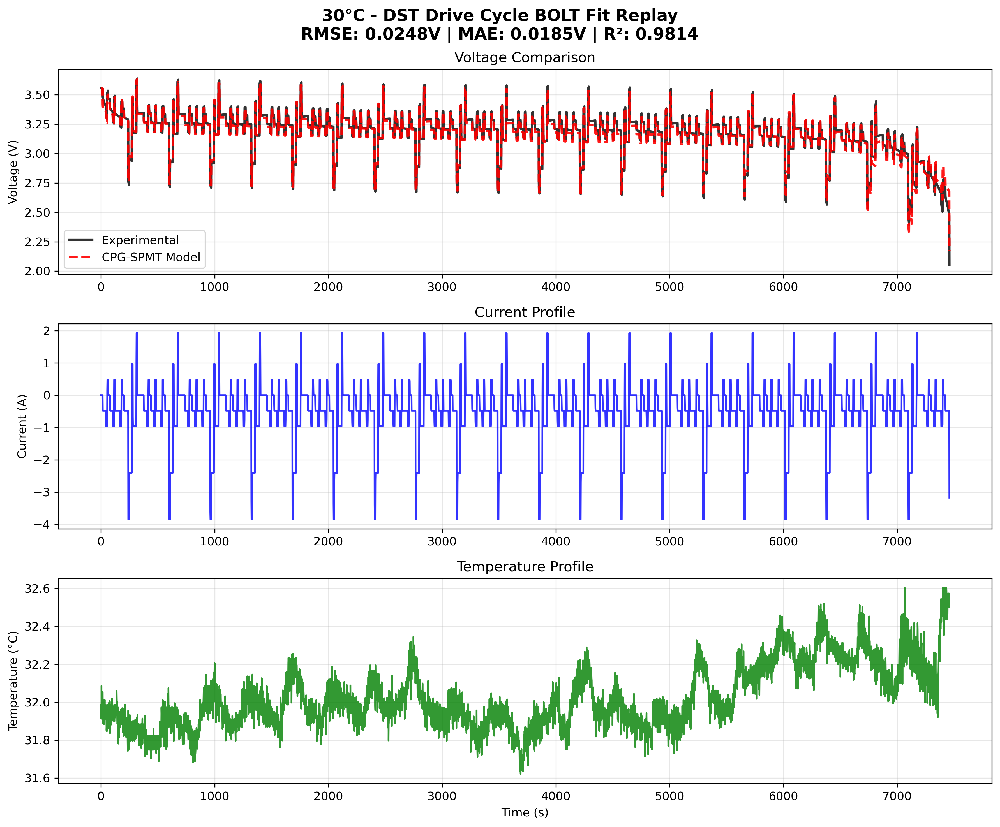
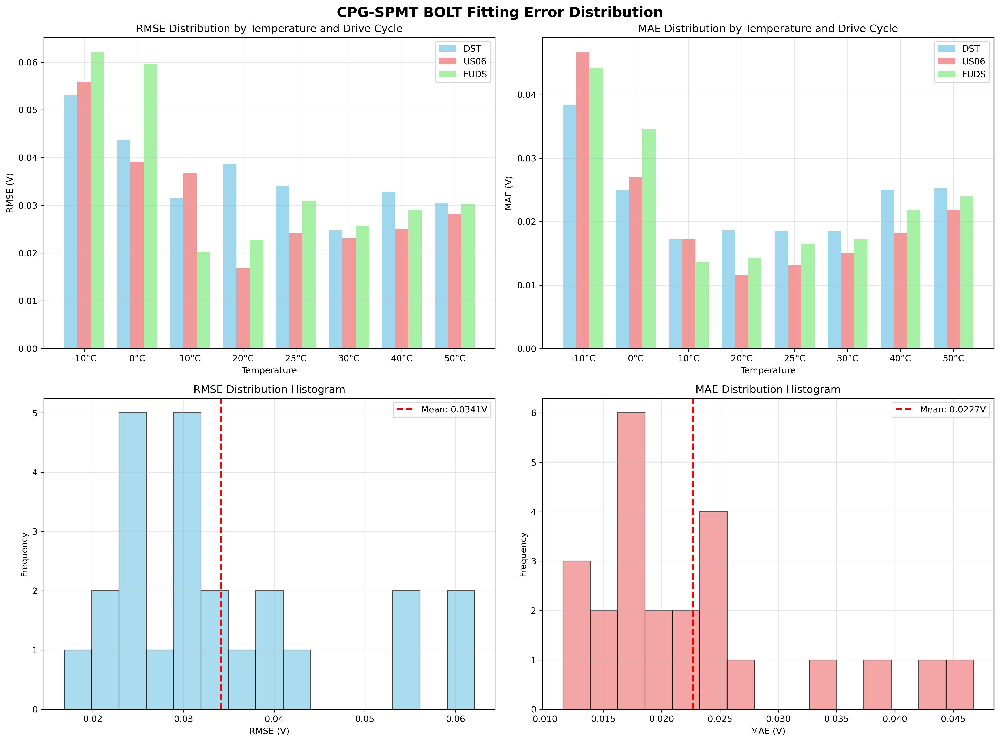

# CPG-SPMT: Control-oriented Parameter-Grouped Single Particle Model with Thermal effects
<!-- markdownlint-disable first-line-h1 -->
<!-- markdownlint-disable html -->
<!-- markdownlint-disable no-duplicate-header -->

<div align="center">
  
</div>

<div align="center" style="line-height: 1.5;">
  <a href="#"></a>
  <a href="LICENSE"></a>
  <a href="#"></a>
  <a href="#"></a>
  <a href="#"></a>
</div>


---

## 📋 Table of Contents

1. [Overview](#overview)
2. [Core Features](#core-features)
3. [Project Structure](#-project-structure)
4. [Installation Requirements](#-installation-requirements)
5. [Usage Guide](#-usage-guide)
6. [Model Validation](#-model-validation)
7. [Validation Results](#-validation-results)
8. [Battery Data Source](#-battery-data-source)
9. [File Descriptions](#-file-descriptions)
10. [Citation](#-citation)
11. [License](#-license)
12. [Contact](#-contact)

---

## Overview

The **CPG-SPMT: Control-oriented Parameter-Grouped Single Particle Model with Thermal effects** uses a **parabolic approximation method** to discretize the SPM's governing PDE, thereby transforming the PDE into a set of ordinary differential equations (ODEs) that can be efficiently integrated over time. This approach reduces computational complexity while preserving the essential dynamics of the battery. Furthermore, the model applies **battery parameter grouping**, reducing the number of required parameters while maintaining accuracy. Its compact state-space formulation supports **battery state estimation** and **control design** within battery management systems. The current and measured cell-temperature profiles are inputs; temperature dependence is represented through Arrhenius parameter scaling.


### Core features

- **PDE Discretization with Parabolic Approximation:**
  The **parabolic approximation method** is used to discretize the PDE that describes lithium diffusion in the electrode, converting it into a tractable **state-space model**. The implementation evaluates the resulting four-state system with an exact zero-order-hold update at a one-second sampling interval; see the [numerical method reference](#-citation).

- **Battery Parameter Grouping:**
  The model groups related parameters, reducing the number of independent parameters required while maintaining accuracy in simulations. The CPG-SPMT model uses **14 parameters total**:

  **9 Core SPM Parameters:**
  - `a_n_1`, `a_p_1`: Grouped negative- and positive-electrode diffusion time parameters at 25°C [s]
  - `b_n`, `b_p`: Grouped negative- and positive-electrode capacities [C per unit electrode coordinate]
  - `d_n_1`, `d_p_1`: Grouped negative- and positive-electrode kinetic coefficients at 25°C [1/s]
  - `soc_n`, `soc_p`: Initial negative- and positive-electrode lithium stoichiometries [-]
  - `R_ini_1`: Grouped series resistance at 25°C [ohm]

  **5 Temperature-dependent Parameters (Activation Energies):**
  - `E_1`, `E_2`: Activation energies associated with `a_n`, `a_p` [J/mol]
  - `E_3`, `E_4`: Activation energies associated with `d_n`, `d_p` [J/mol]
  - `E_5`: Activation energy associated with `R_ini` [J/mol]

- **Battery Simulation:**
  The model computes the **terminal voltage response** based on **two input profiles: current (A) and temperature (°C)**, making it suitable for simulating battery behavior under various operating conditions and thermal environments.

- **State Estimation and Control:**
  The compact model is intended for **battery state estimation** and **control** applications in battery management systems (BMS).

---

## 📁 Project Structure

```
CPG-SPMT/
├── cpg_spmt.py                    # Core model implementation
├── model_validation.py            # Replay and error analysis for all 24 fitted conditions
├── calibration/                   # BOLT parameters, bounds, metrics and run summary
├── references.bib                 # Model and BOLT method references
├── README.md                      # Project documentation
├── cpg_spmt_logo.png              # Project logo
├── LICENSE                        # Apache License 2.0
├── data/                          # Experimental data
│   ├── A1-007-DST-US06-FUDS-N10-20120829_modified.xlsx  # -10°C data
│   ├── A1-007-DST-US06-FUDS-0-20120813_modified.xlsx    # 0°C data
│   ├── A1-007-DST-US06-FUDS-10-20120815_modified.xlsx   # 10°C data
│   ├── A1-007-DST-US06-FUDS-20-20120817_modified.xlsx   # 20°C data
│   ├── A1-007-DST-US06-FUDS-25-20120827_modified.xlsx   # 25°C data
│   ├── A1-007-DST-US06-FUDS-30-20120820_modified.xlsx   # 30°C data
│   ├── A1-007-DST-US06-FUDS-40-20120822_modified.xlsx   # 40°C data
│   └── A1-007-DST-US06-FUDS-50-20120824_modified.xlsx   # 50°C data
└── validation_results/            # Validation results
    ├── *C_*_validation.png        # 24 individual validation plots (including 30C_DST_validation.png for Figure 1)
    ├── error_distribution_analysis.png     # Error distribution analysis (Figure 2)
    ├── validation_summary_comparison.png   # Validation results comparison
    ├── cpg_spmt_validation_results.csv     # Main validation results
    └── detailed_validation_errors.csv      # Detailed error data
```

---

## 🛠️ Installation Requirements

### System Requirements
- Python 3.9+
- Operating System: Windows, macOS, Linux

### Dependencies
```bash
pip install numpy scipy matplotlib pandas openpyxl
```

### Detailed Dependencies
- **numpy**: Numerical computation (the core model only requires NumPy)
- **scipy**: Linear interpolation for experimental-data preprocessing
- **matplotlib**: Data visualization and plotting
- **pandas**: Data processing and analysis
- **openpyxl**: Excel file reading

---

## 🚀 Usage Guide

### 1. Basic Usage with Experimental Data Validation

This example replays the 30°C DST (Dynamic Stress Test) data using the latest BOLT parameters. The model takes **current profile (A)** and **temperature profile (°C)** as inputs and outputs **voltage response (V)**.

> **📖 Note**: If you use this model in your research, please [cite the related publications](#-citation).

```python
from pathlib import Path
from cpg_spmt import cpg_spmt
from model_validation import load_experimental_data, calculate_error_metrics
import matplotlib.pyplot as plt

# The model requires a uniform one-second grid. This loader applies the same
# linear interpolation used for calibration, with the final endpoint excluded.
data_file = Path("data/A1-007-DST-US06-FUDS-30-20120820_modified.xlsx")
exp_data = load_experimental_data(data_file, sheet_name="DST", temperature=30)
time_exp = exp_data["time"]
current_exp = exp_data["current"]
voltage_exp = exp_data["voltage"]
temperature_exp = exp_data["temperature"]  # measured cell temperature [degrees C]

# Positive current = charge; negative current = discharge.
voltage_sim = cpg_spmt(current_exp, temperature_exp)
metrics = calculate_error_metrics(voltage_exp, voltage_sim)
rmse, mae, r_squared = metrics["RMSE"], metrics["MAE"], metrics["R_squared"]

print("CPG-SPMT BOLT Fit Replay (30°C DST)")
print(f"Samples: {len(time_exp)}; duration: {time_exp[-1]:.0f} s")
print(f"RMSE: {rmse:.6f} V; MAE: {mae:.6f} V; R²: {r_squared:.6f}")

# Plot comparison with three subplots
plt.figure(figsize=(14, 10))

# Voltage comparison
plt.subplot(3, 1, 1)
plt.plot(time_exp/3600, voltage_exp, 'k-', label='Experimental', linewidth=1.5, alpha=0.8)
plt.plot(time_exp/3600, voltage_sim, 'r--', label='CPG-SPMT Model', linewidth=1.5)
plt.ylabel('Voltage (V)')
plt.title(f'30°C DST BOLT Fit Replay - RMSE: {rmse:.4f}V, MAE: {mae:.4f}V, R²: {r_squared:.4f}')
plt.legend()
plt.grid(True, alpha=0.3)

# Current profile
plt.subplot(3, 1, 2)
plt.plot(time_exp/3600, current_exp, 'b-', linewidth=1.5)
plt.ylabel('Current (A)')
plt.title('DST Current Profile')
plt.grid(True, alpha=0.3)

# Temperature profile
plt.subplot(3, 1, 3)
plt.plot(time_exp/3600, temperature_exp, 'g-', linewidth=1.5)
plt.xlabel('Time (hours)')
plt.ylabel('Temperature (°C)')
plt.title('Temperature Profile')
plt.grid(True, alpha=0.3)

plt.tight_layout()
plt.savefig('readme_basic_usage_example.png', dpi=300, bbox_inches='tight')
plt.show()
```

**Expected Output:**

<div align="center">
  
  <p><em>Figure 1: CPG-SPMT BOLT Fit Replay using 30°C DST Data</em></p>
</div>

The plot compares measured and simulated voltage (top), the DST current profile (middle), and measured cell temperature (bottom). With the latest BOLT parameters, RMSE = 0.024776 V, MAE = 0.018466 V, and R² = 0.981361.

### 2. Custom Parameters

```python
from cpg_spmt import cpg_spmt, DEFAULT_PARAM, PARAMETER_NAMES

# Custom parameters use the same 14-element sequence as DEFAULT_PARAM.
custom_params = list(DEFAULT_PARAM)
custom_params[PARAMETER_NAMES.index("R_ini_1")] = 0.15  # ohm at 25°C
voltage = cpg_spmt(current_exp, temperature_exp, param=custom_params)
```

### 3. Run Complete Validation

```bash
# Run model validation script
python model_validation.py
```

The validation script will:
- 🔄 Process all temperature conditions (-10°C to 50°C)
- 📊 Generate 24 individual validation plots
- 📈 Create error distribution analysis plots
- 💾 Save all results to `validation_results/` folder

---

## 🔬 Model Validation

### Validation Dataset

We re-estimated the CPG-SPMT parameters using **BOLT (Batch-Optimized Local-to-Global Technique)**. All 24 conditions below were used jointly to estimate the 14 parameters, including one shared pair of initial electrode stoichiometries and five activation energies. The results in this repository therefore report **fitting errors on the calibration data**. The existing `model_validation.py` and `validation_results/` names are retained for compatibility.

- **Data Source**: A1-007 lithium-ion battery experimental data
- **Temperature Range**: -10°C, 0°C, 10°C, 20°C, 25°C, 30°C, 40°C, 50°C
- **Driving Cycles**: DST, US06, FUDS
- **Total Test Conditions**: 24 (8 temperatures × 3 conditions)
- **Total Samples**: 166,992 on a uniform 1 s grid
- **Temperature Input**: Measured cell-temperature profile, rather than the ambient-temperature label
- **Current Convention**: Positive for charge, negative for discharge
- **Voltage Output Limits**: 2.0–3.9 V; reported errors use this model output

### BOLT Parameter Estimation

The latest calibration used **64 TRF local refinements on 16 CPUs, arranged in four batches**. Diversified initial candidates were refined by nonlinear least squares using every voltage sample. All 64 refinements converged; the final candidate was selected by the lowest average MAE across the 24 conditions among converged, trajectory-feasible candidates. Both initial electrode stoichiometries were estimated in the range 0–1, with concentration-domain feasibility enforced throughout each trajectory.

The reference temperature is **25°C**. The latest parameter values and estimation bounds are:

| Parameter | Value | Unit | Lower bound | Upper bound |
| --- | ---: | --- | ---: | ---: |
| `a_n_1` | 3772.92828974 | s | 0 | 25000 |
| `a_p_1` | 373.92618594 | s | 0 | 25000 |
| `b_n` | 12351.5222115 | C | 3171.6 | 15840 |
| `b_p` | 3974.54979324 | C | 3168 | 7920 |
| `d_n_1` | 0.00415110645739 | 1/s | 1e-08 | 3.12 |
| `d_p_1` | 0.312959720906 | 1/s | 1e-08 | 100 |
| `soc_n` | 0.34736051269 | - | 0 | 1 |
| `soc_p` | 0.000273326645769 | - | 0 | 1 |
| `E_1` | 37506.041582 | J/mol | 0 | 200000 |
| `E_2` | 46010.8390956 | J/mol | 0 | 200000 |
| `E_3` | 125951.046392 | J/mol | 0 | 200000 |
| `E_4` | 131036.914672 | J/mol | 0 | 200000 |
| `E_5` | 3675.98172239 | J/mol | 0 | 200000 |
| `R_ini_1` | 0.155310094196 | ohm | 0 | 0.5 |

Capacity bounds are expressed in C (`Ah × 3600`): the negative-electrode upper bound is 4.4 Ah and the positive-electrode upper bound is 2.2 Ah. Full-precision values are in [`calibration/parameters.json`](calibration/parameters.json); bounds, units and short descriptions are in [`calibration/parameter_bounds.csv`](calibration/parameter_bounds.csv). The run settings and all 64 candidates are in [`fit_summary.json`](calibration/fit_summary.json) and [`multistart_results.csv`](calibration/multistart_results.csv).

For the BOLT method, see Guo et al., *Applied Energy* 422 (2026), 128307, [doi:10.1016/j.apenergy.2026.128307](https://doi.org/10.1016/j.apenergy.2026.128307).

### Validation Metrics
- **RMSE** (Root Mean Square Error): Voltage prediction accuracy
- **MAE** (Mean Absolute Error): Mean absolute error
- **R²** (Coefficient of Determination): Fraction of measured-voltage variance explained by the model


---

## 📊 Validation Results

### 🎯 Overall Performance
- **Average RMSE across conditions**: 0.034121 V
- **Average MAE across conditions**: 0.022667 V
- **Average R² across conditions**: 0.966491
- **Pooled RMSE across all samples**: 0.035280 V
- **Pooled MAE across all samples**: 0.021985 V
- **Temperature Range**: Eight ambient-temperature conditions from -10°C to 50°C

Condition averages assign equal weight to each condition; pooled metrics assign equal weight to each sample. These are fitting-data results.

### 📊 Comprehensive Validation Results

<div align="center">
  
  <p><em>Figure 2: CPG-SPMT Model Error Distribution Analysis Across All Temperature and Drive Cycle Conditions</em></p>
</div>

The plots summarize the fitting errors across all temperature and drive-cycle conditions. The mean condition RMSE is 0.034121 V and the mean condition MAE is 0.022667 V. Per-condition MAE, RMSE, bias, maximum absolute error and R² are available in [`calibration/condition_metrics.csv`](calibration/condition_metrics.csv); the 24 individual plots are in [`validation_results/`](validation_results/).

---

## 🔋 Battery Data Source

The experimental validation data used in this project is sourced from the **University of Maryland Battery Laboratory (CALCE)**.

### Data Source Information
- **Institution**: [CALCE Battery Research Group, University of Maryland](https://calce.umd.edu/battery-data)


### Battery Specifications (A123 Reference)
Based on the CALCE database,  A123 battery specifications include:

| **Battery Parameter**    | **Specification**     |
| ------------------------ | --------------------- |
| **Capacity Rating**     | 1100 mAh             |
| **Cell Chemistry**      | LiFePO4              |
| **Diameter**            | 18 mm                |
| **Length**              | 65 mm                |


---

## 📄 File Descriptions

### Core Files

#### `cpg_spmt.py`
Main model implementation file containing:
- `cpg_spmt()`: Main simulation function
- `ocp_pos()`, `ocp_neg()`: Positive and negative electrode OCV functions
- `update_temperature_dependent_parameters()`: Temperature parameter updates
- `build_state_space_matrices()`: Continuous-time state-space matrices
- `build_discrete_state_space_matrices()`: Exact discrete-time update, including zero time-parameter limits
- `compute_overpotentials()`: Dimensionless Butler–Volmer arguments; electrode overpotential voltages are evaluated in `cpg_spmt()`
- `DEFAULT_PARAM`: Latest full-precision 14-parameter BOLT estimate

#### `model_validation.py`
Calibration-data replay script with features:
- Experimental data loading and preprocessing
- Model simulation and error calculation
- Results visualization and report generation
- Batch validation processing

### Data Files

#### `data/` Folder
Contains 8 Excel files, each corresponding to one temperature condition:
- Each file contains DST, US06, FUDS worksheets
- Data columns: Time, Voltage, Current, Temperature
- Data preprocessed and quality checked

#### `validation_results/` Folder
Validation results output folder:
- **Individual plots**: 24 PNG images, one per condition
- **Summary plots**: Error distribution analysis and comparison plots
- **Data files**: CSV format validation results and detailed data

---

## 📚 Citation

If you use this model in your research or projects, please cite the relevant model papers and the BOLT method used for parameter estimation:

**BOLT Parameter Estimation Method:**
> Guo, F., Couto, L. D., Haghverdi, K., Trad, K., & Mulder, G. (2026). Rapid and robust parameter estimation for electrochemical battery models via BOLT: A batch-optimized local-to-global technique. *Applied Energy*, 422, 128307. https://doi.org/10.1016/j.apenergy.2026.128307

**Software Implementation Reference:**
> Guo, Feng, and Luis D. Couto. "CPG-SPMT: Control-Oriented Parameter-Grouped Single Particle Model with Thermal Effects for Lithium-Ion Batteries." *Computer Physics Communications* (2026): 110075. https://doi.org/10.1016/j.cpc.2026.110075

**Primary Reference:**
> Guo, Feng, and Luis D. Couto. "A control-oriented simplified Single Particle Model with grouped parameter and sensitivity analysis for lithium-ion batteries." *Journal of Power Sources* 649 (2025): 237309. https://doi.org/10.1016/j.jpowsour.2025.237309

**Numerical Method Reference:**
> Guo, Feng, and Luis D. Couto. "Comparative performance analysis of numerical discretization methods for electrochemical model of lithium-ion batteries." *Journal of Power Sources* 650 (2025): 237365. https://doi.org/10.1016/j.jpowsour.2025.237365

**BibTeX Format:**
```bibtex
@article{guo2026bolt,
  title={Rapid and robust parameter estimation for electrochemical battery models via BOLT: A batch-optimized local-to-global technique},
  author={Guo, Feng and Couto, Luis D. and Haghverdi, Keivan and Trad, Khiem and Mulder, Grietus},
  journal={Applied Energy},
  volume={422},
  pages={128307},
  year={2026},
  publisher={Elsevier},
  doi={10.1016/j.apenergy.2026.128307}
}

@article{guo2026cpg,
  title={CPG-SPMT: Control-Oriented Parameter-Grouped Single Particle Model with Thermal Effects for Lithium-Ion Batteries},
  author={Guo, Feng and Couto, Luis D.},
  journal={Computer Physics Communications},
  pages={110075},
  year={2026},
  publisher={Elsevier},
  doi={10.1016/j.cpc.2026.110075}
}

@article{guo2025cpg,
  title={A control-oriented simplified Single Particle Model with grouped parameter and sensitivity analysis for lithium-ion batteries},
  author={Guo, Feng and Couto, Luis D.},
  journal={Journal of Power Sources},
  volume={649},
  pages={237309},
  year={2025},
  publisher={Elsevier},
  doi={10.1016/j.jpowsour.2025.237309}
}

@article{guo2025comparative,
  title={Comparative performance analysis of numerical discretization methods for electrochemical model of lithium-ion batteries},
  author={Guo, Feng and Couto, Luis D.},
  journal={Journal of Power Sources},
  volume={650},
  pages={237365},
  year={2025},
  publisher={Elsevier},
  doi={10.1016/j.jpowsour.2025.237365}
}
```


---

## 📜 License

This project is licensed under the **[Apache License 2.0](LICENSE)**.

### License Highlights
- ✅ Commercial, academic, and research use
- ✅ Modification and redistribution under the license terms
- ✅ Express patent license from contributors
- ❗ Retain the license, copyright, and attribution notices
- ❗ State significant changes to modified files
- ❗ No warranty is provided

---

## 📧 Contact

**Author**: Feng Guo<br>

**Email**: feng.guo [at] vito [dot] be<br>

**Homepage**: [franksuperg.github.io/feng-guo-academic](https://franksuperg.github.io/feng-guo-academic/)<br>

**Google Scholar**: [scholar.google.com/citations?user=z2SHUxkAAAAJ&hl=en](https://scholar.google.com/citations?user=z2SHUxkAAAAJ&hl=en)

### Technical Support
- 🐛 Bug reports: Please contact via email
- 💡 Feature suggestions: Welcome improvement suggestions
- 🤝 Collaboration opportunities: I can support **parameter identification** using your provided battery test data, and welcome academic/industrial partnerships including joint paper writing.
- 📖 **Academic Use**: Please remember to [cite our publications](#-citation) when using this model

---

<div align="center">
  <p><strong>🔋 Making Battery Modeling Simpler, Energy Management Smarter!</strong></p>
  <p><em>CPG-SPMT © 2025 Feng Guo. Licensed under Apache-2.0.</em></p>
</div>
